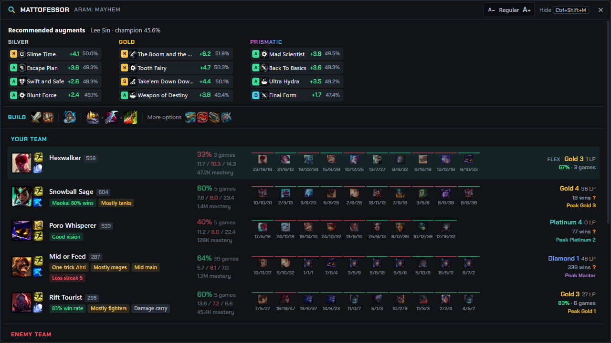
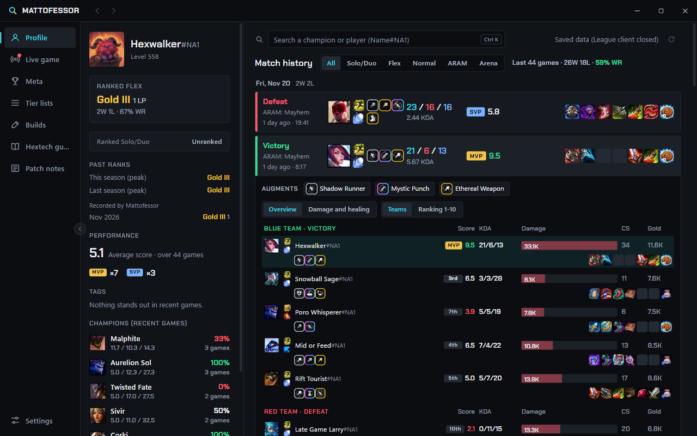
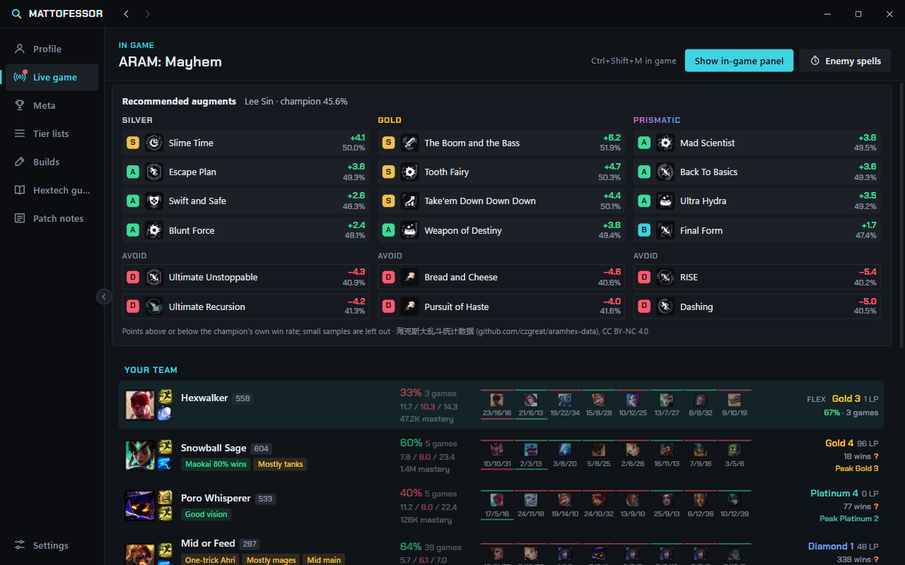
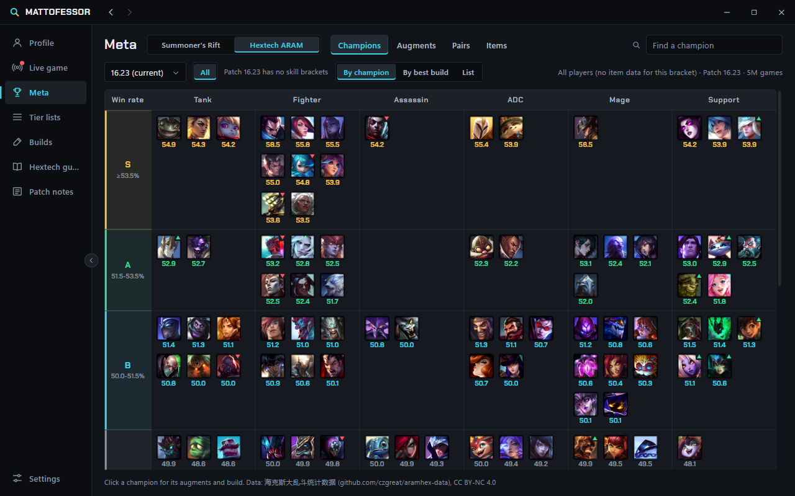
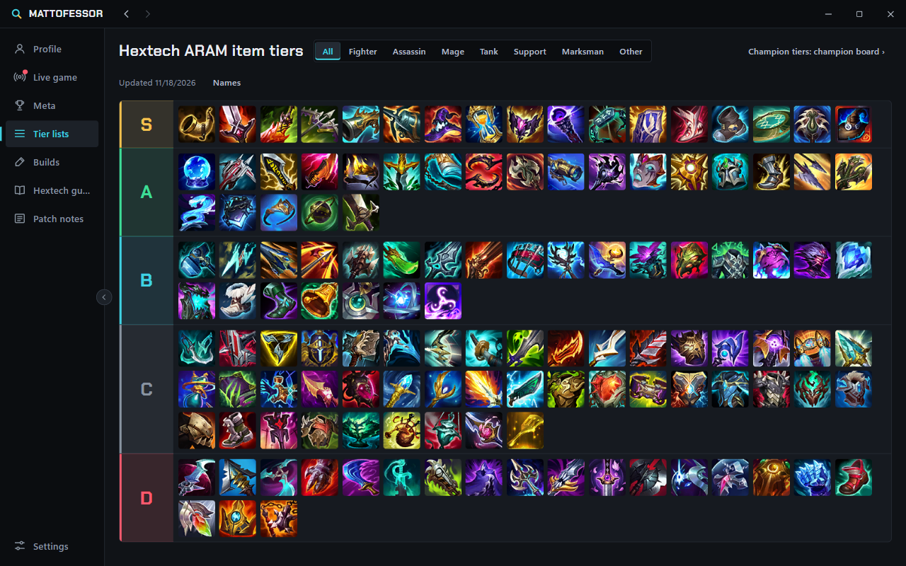
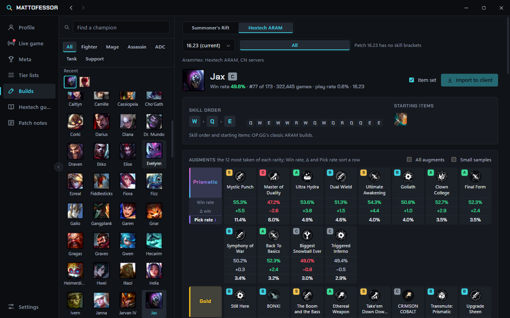
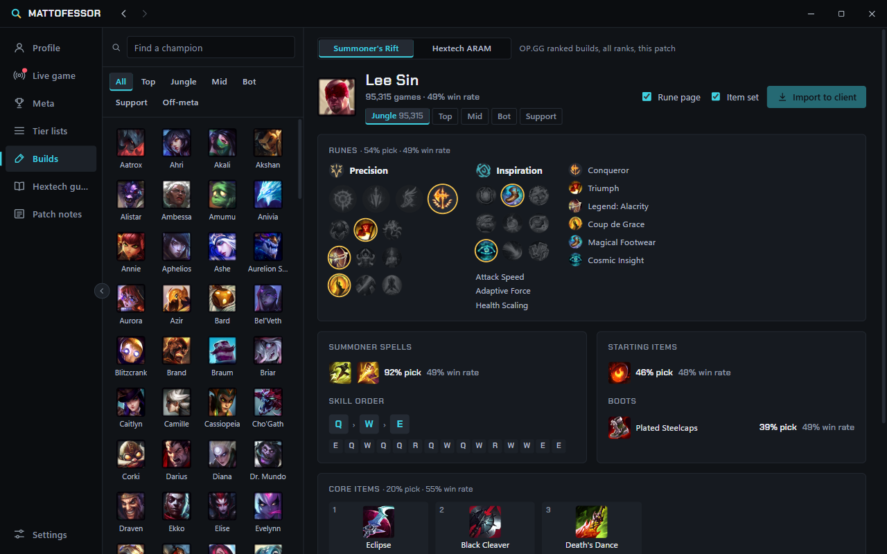
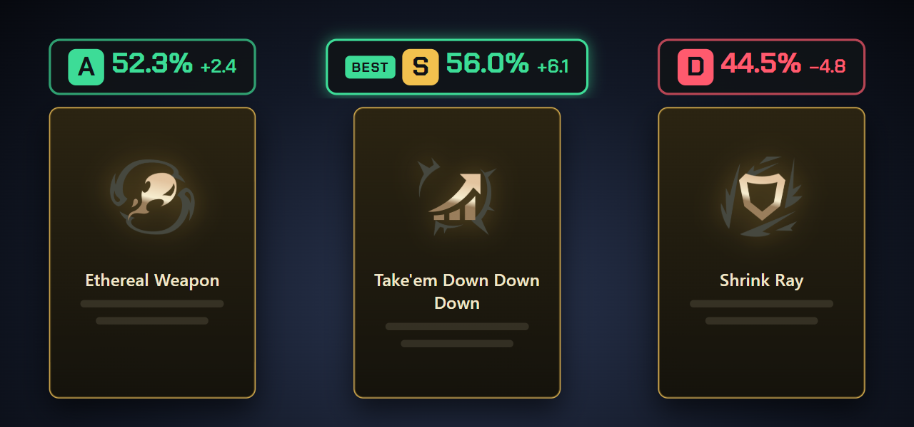
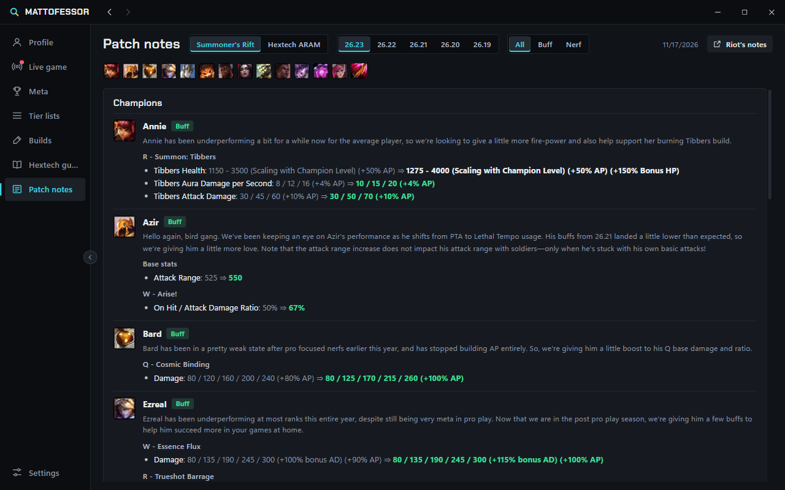

# Mattofessor

[English](README.md) · [简体中文](README.zh-CN.md) · [繁體中文](README.zh-TW.md) · [日本語](README.ja.md) · [한국어](README.ko.md) · **Español** · [Français](README.fr.md) · [Русский](README.ru.md)

Un asistente local para League of Legends en Windows y macOS que sustituye a Porofessor, sin Overwolf, sin anuncios y sin cuentas. Disponible en español, inglés, chino simplificado y tradicional, japonés, coreano, francés y ruso.

> Esta página explica cómo instalarlo y usarlo. Para desarrollar, compilar o publicar versiones, consulta el [README](README.md) en inglés.

Los nombres de jugadores de las imágenes son inventados.

## Funciones

### Perfil

La clasificación en solo/dúo y flexible (tuya o de cualquier Riot ID), clasificaciones anteriores, etiquetas, campeones más jugados, roles, maestría e historial de partidas, con los datos completos de los 10 jugadores de cada partida (objetos y oro, o daño infligido, recibido, mitigado y curación).

### Partida en curso

Durante la selección de campeones analiza a tu equipo y, cuando empieza la partida, a todos (Arena incluida). De cada jugador muestra su clasificación y la más alta que ha tenido, si puede ser una cuenta secundaria, partidas, porcentaje de victorias, KDA y maestría con su campeón, el KDA de sus últimas 5 partidas y etiquetas (especialista, campeón fuerte, porcentaje de victorias, el tipo de campeón que más juega, grupo premade...). ARAM: Caos y ARAM se valoran solo con partidas de ese modo, sin las etiquetas de la Grieta del Invocador (rol, farmeo, muertes).

### Panel en partida

`Ctrl+Shift+M` lo muestra u oculta sobre el juego (elegido para no chocar con el `Ctrl+X` de Porofessor, así funcionan a la vez). También aparece solo en la pantalla de carga y se oculta cuando empieza la partida. `Ctrl+Shift+N` activa o desactiva los temporizadores de los hechizos de invocador enemigos (haz clic en un hechizo cuando lo usen). Los dos atajos solo funcionan durante una partida.

### Meta

Clasificaciones por rol de la Grieta del Invocador (porcentaje de victorias, de selección y de bloqueo) y porcentajes de victorias de campeones y aumentos en ARAM: Caos, por nivel de habilidad.

<table>
  <tr>
    <td width="50%"></td>
    <td width="50%"></td>
  </tr>
</table>

### Builds

Runas con fragmentos de estadísticas, hechizos, orden de habilidades, objetos iniciales, botas y objetos para la Grieta del Invocador (por rol) y para ARAM. Se importan al cliente con un clic, o solos al fijar el campeón. En ARAM: Caos la página de builds también ordena los aumentos del campeón. Al importar en ARAM: Caos se añade un conjunto de objetos por cada estilo de build, en el idioma del cliente. En la selección de campeones, cada campeón de tu equipo y del banquillo muestra su mejor estilo de build, y ves los tres mejores aumentos de tu campeón.

<table>
  <tr>
    <td width="50%"></td>
    <td width="50%"></td>
  </tr>
</table>

### Aumentos de ARAM: Caos

En la selección de campeones y en partida, los aumentos que conviene elegir y evitar con tu campeón, por rareza. Cuando se abren las cartas de aumentos, encima de cada una aparece el porcentaje de victorias de tu campeón con ella, y la mejor queda marcada. Las cartas se leen con el reconocimiento de texto propio de Windows, en el idioma del cliente o en inglés; no se guarda nada. Cada carta lleva además una letra de nivel, de S a D, según cuánto mejora a tu campeón, y el aumento en el que haces clic se recuerda y aparece en el panel en partida.

Las caras de las cartas están dibujadas para esta imagen; en partida los porcentajes aparecen sobre las cartas del propio juego.

### Notas del parche

Los cambios de los últimos 5 parches, con la Grieta del Invocador y ARAM: Caos por separado, tomados de las notas oficiales de Riot en español.

### Puntuaciones

Cada jugador de cada partida recibe una puntuación de rendimiento de 0,0 a 10,0 y un puesto (del 1.º al 10.º). El mejor del equipo ganador es el MVP y el mejor del perdedor, el SVP.

### Pequeños detalles

Acepta la partida encontrada por sí solo si quieres (desactivado, solo ARAM: Caos o todas las colas). Mantén Tab en partida para ver el valor en objetos de cada equipo y la diferencia. Ajusta la opacidad de las ventanas en partida y fija los temporizadores de hechizos en su sitio.

## Instalación

1. Abre la página **Releases** de este repositorio (a la derecha en GitHub) y descarga `Mattofessor_x.y.z_x64-setup.exe` de la última versión. No uses "Download ZIP": eso es el código fuente.
2. Ejecútalo. Como el instalador no tiene firma de código, Windows puede mostrar "Windows protegió su PC": haz clic en **Más información** y luego en **Ejecutar de todas formas**. Pide permisos de administrador, se instala en `C:\Program Files\Mattofessor` y crea un acceso directo en el escritorio.
3. Abre League of Legends e inicia sesión; Mattofessor se conecta solo. Se inicia con Windows (puedes desactivarlo en Ajustes).
4. Opcional: consigue tu propia clave gratuita de la API de Riot para ver las victorias y derrotas exactas en clasificatorias: Ajustes > Clave de la API de Riot (opcional) > **Guía paso a paso con imágenes**. Cada persona usa su propia clave; no compartas la tuya.

Necesita Windows 10 u 11 (WebView2 se instala solo si falta). Para que el panel aparezca sobre el juego, League debe estar en modo **Sin bordes** o **En ventana**. Atajos: `Ctrl+Shift+M` panel, `Ctrl+Shift+N` temporizadores de hechizos enemigos (se pueden cambiar en Ajustes). Para desinstalarlo, ve a Configuración de Windows > Aplicaciones. Los ajustes y la caché están en `%APPDATA%\Mattofessor`.

### Si el antivirus lo bloquea

Algunos antivirus bloquean o ponen en cuarentena el instalador y lo llaman troyano o programa de robo de datos. Es un falso positivo, por dos motivos: el instalador no tiene firma de código y la aplicación lee el archivo local de inicio de sesión del cliente de League (lockfile) y la pantalla, justo lo que vigilan esos programas. Descárgalo solo desde la página Releases de este repositorio; después restaura el archivo y añádelo, junto con `C:\Program Files\Mattofessor`, a la lista de confianza (exclusiones) del antivirus.

### macOS

1. Descarga `Mattofessor_x.y.z_universal.dmg` de la última versión (Apple Silicon e Intel), ábrelo y arrastra Mattofessor a Aplicaciones.
2. Para ver las victorias en las cartas de aumento, permite Mattofessor en **Ajustes del Sistema > Privacidad y seguridad > Grabación de pantalla y audio del sistema** (Ajustes > Lector de aumentos tiene un botón) y reinicia Mattofessor.

Necesita macOS 13 o posterior (las victorias en las cartas, macOS 14). Mattofessor vive en la barra de menús; los ajustes están en `~/Library/Application Support/Mattofessor` y la clave de Riot en tu llavero.

## Actualizaciones

Mattofessor busca la última versión de este repositorio en segundo plano (sin cuenta de GitHub): cada 30 minutos y al abrir la ventana o volver a ella. Cuando hay una versión nueva aparece un aviso: haz clic en **Actualizar ahora**, acepta el aviso de Windows y se reinicia con la nueva versión. Nunca se actualiza durante una partida. En Ajustes > Actualizaciones puedes desactivar la búsqueda automática o pulsar **Buscar actualizaciones**.

## Idiomas

En Ajustes > Idioma eliges uno o dejas que siga al cliente de League. Cada idioma muestra solo su propio texto: los nombres y descripciones de campeones, objetos y aumentos, las reglas y las notas del parche vienen de los datos oficiales de Riot en ese idioma. Lo que aún no está traducido se oculta y se cuenta, sin mezclar otro idioma.

## Opcional: clave de la API de Riot

El cliente de League oculta las derrotas en clasificatorias de los demás jugadores. Con una clave de la API de Riot verás las victorias, derrotas y porcentajes exactos de todos, y la detección de cuentas secundarias será más precisa. Entra en [developer.riotgames.com](https://developer.riotgames.com/) con tu cuenta de Riot y elige Register Product > Personal API Key: es solo para uso personal, se aprueba al momento y no caduca. La Development API Key del panel caduca a las 24 horas, por eso la guía de la aplicación no la usa. La clave se guarda cifrada con DPAPI de Windows en tu PC y nunca se muestra en pantalla.

## De dónde salen los datos

- La API local del cliente de League con tu sesión iniciada (LCU) y la Live Client Data API del juego. Los nombres e iconos vienen de Data Dragon, el CDN público de Riot. No hay ningún servidor propio.
- Clasificaciones y builds de la Grieta del Invocador: el servicio público de OP.GG ([opgginc/opgg-mcp](https://github.com/opgginc/opgg-mcp)).
- Porcentajes de victorias de ARAM: Caos: 海克斯大乱斗统计数据 ([czgreat/aramhex-data](https://github.com/czgreat/aramhex-data)), con licencia [CC BY-NC 4.0](https://creativecommons.org/licenses/by-nc/4.0/), a partir de millones de partidas en los servidores de China. Mattofessor cita la fuente allí donde aparecen estas cifras y es gratis para siempre (sin fines comerciales).
- Ajustes de campeones en ARAM: Caos: la [League of Legends Wiki](https://wiki.leagueoflegends.com/en-us/ARAM:_Mayhem) (CC BY-SA 3.0). Nombres y descripciones de aumentos: datos del juego de Riot (vía [CommunityDragon](https://communitydragon.org)).
- Notas del parche: las notas oficiales de Riot en cada idioma.

## Licencia

El código está bajo la [licencia MIT](LICENSE). Los datos que muestra conservan su propia licencia: los de AramHex, CC BY-NC 4.0; los de la League of Legends Wiki, CC BY-SA 3.0; los datos del juego y las notas del parche pertenecen a Riot.

## Aviso legal

Mattofessor no está respaldado por Riot Games y no refleja las opiniones de Riot Games ni de nadie que participe oficialmente en la producción o gestión de las propiedades de Riot Games. Riot Games y todas sus propiedades asociadas son marcas comerciales o marcas comerciales registradas de Riot Games, Inc.
