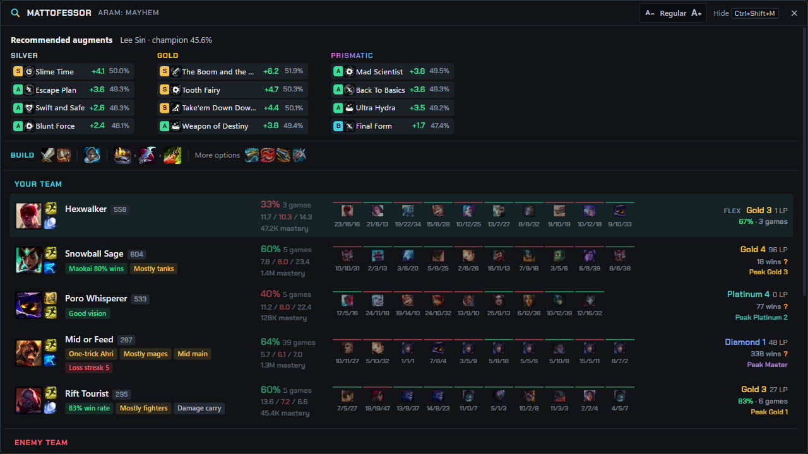
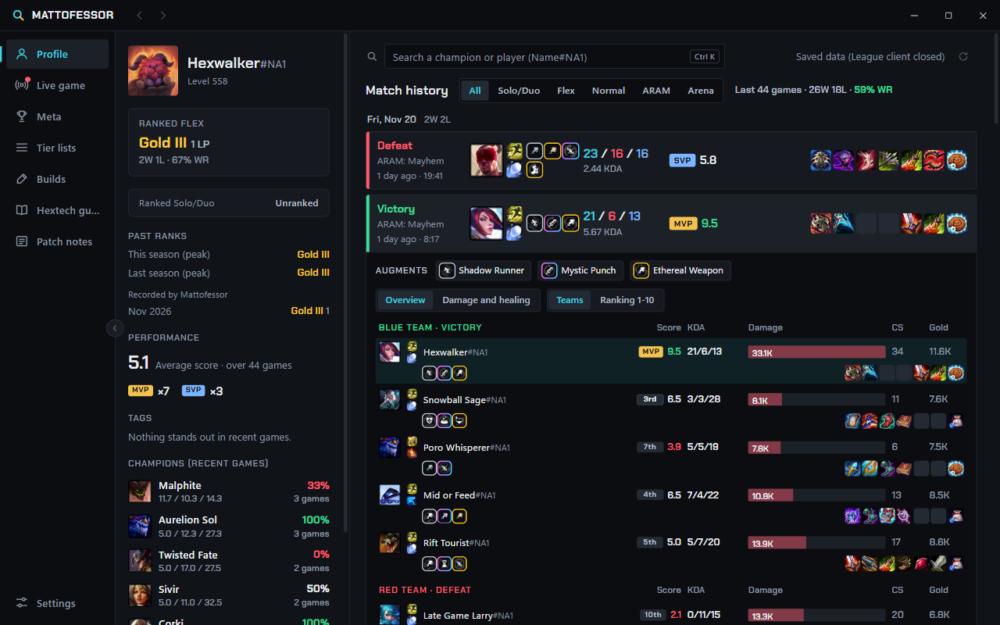
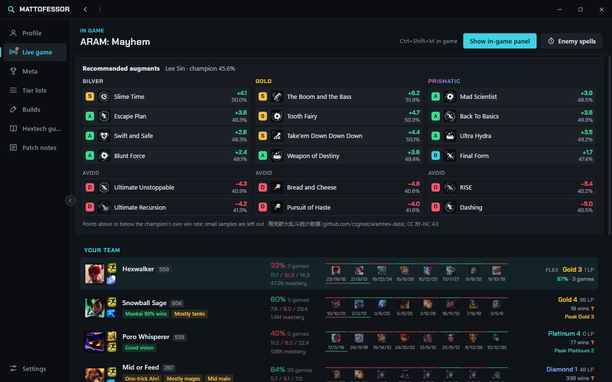
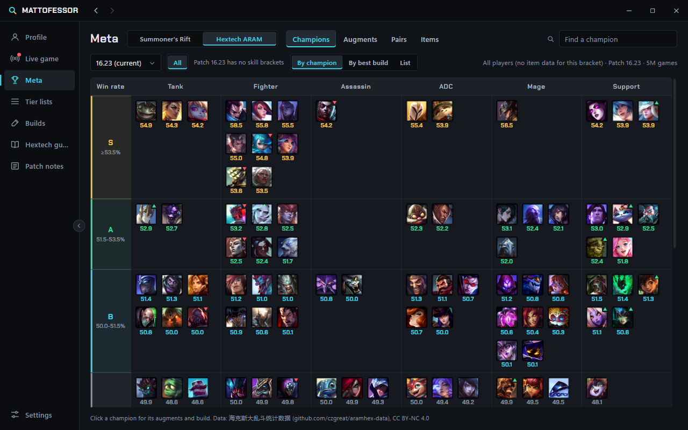
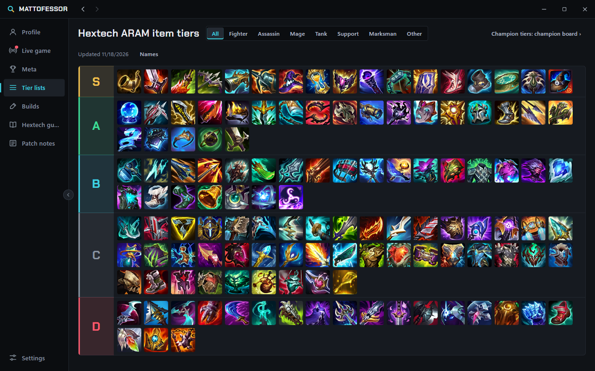
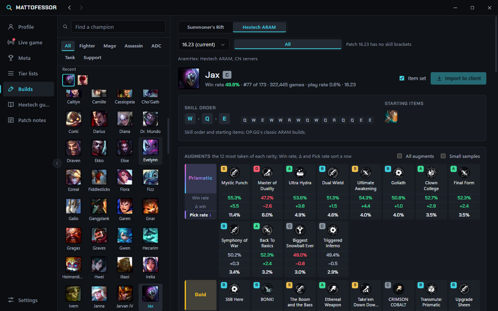
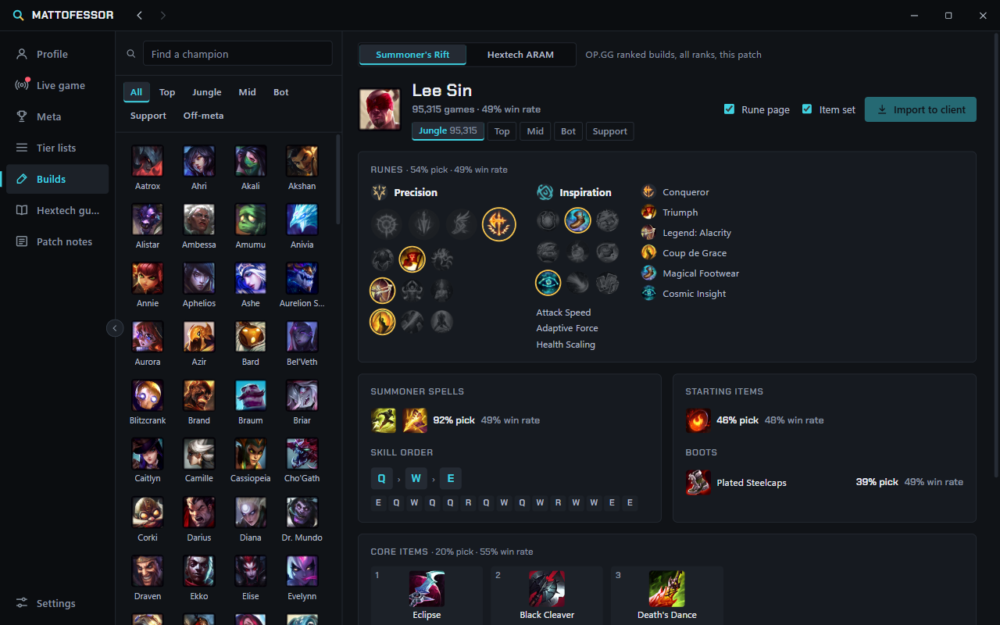
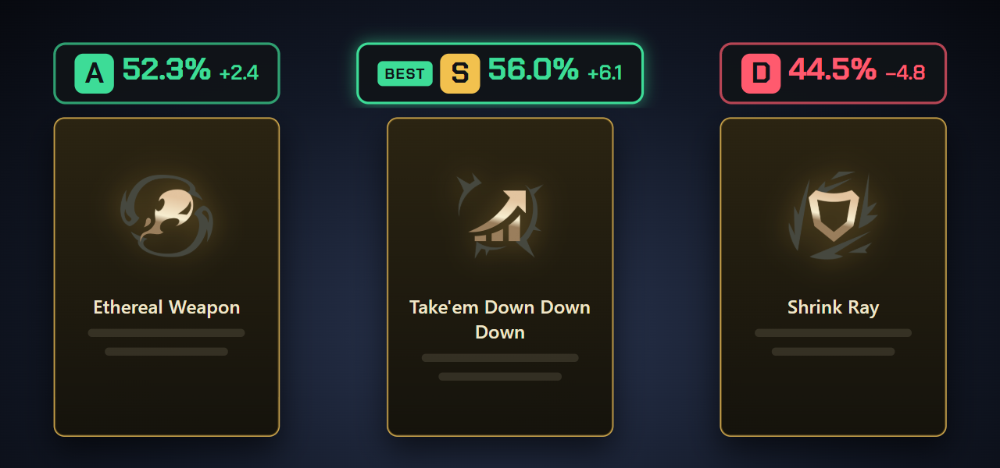
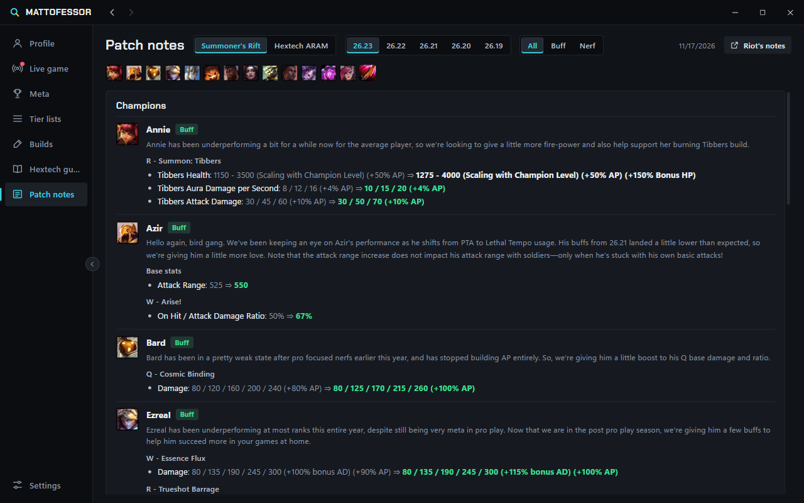

# Mattofessor

[English](README.md) · [简体中文](README.zh-CN.md) · [繁體中文](README.zh-TW.md) · [日本語](README.ja.md) · [한국어](README.ko.md) · [Español](README.es.md) · **Français** · [Русский](README.ru.md)

Un assistant local pour League of Legends sous Windows et macOS qui remplace Porofessor, sans Overwolf, sans publicité et sans compte. En français, anglais, chinois simplifié et traditionnel, japonais, coréen, espagnol et russe.

> Cette page explique comment l'installer et l'utiliser. Pour développer, compiler ou publier une version, voir le [README](README.md) en anglais.

Les noms de joueurs sur les images sont inventés.

<!-- nav -->
**[Fonctionnalités](#fonctionnalités):** [Profil](#profil) · [Partie en cours](#partie-en-cours) · [Panneau en jeu](#panneau-en-jeu) · [Méta](#méta) · [Builds](#builds) · [Augments de l'ARAM du chaos](#augments-de-laram-du-chaos) · [Notes de patch](#notes-de-patch) · [Scores](#scores) · [Petits plus](#petits-plus)  
[Installation](#installation) · [Mises à jour](#mises-à-jour) · [Langues](#langues) · [Facultatif : clé d'API Riot](#facultatif--clé-dapi-riot) · [D'où viennent les données](#doù-viennent-les-données) · [Licence](#licence) · [Mentions légales](#mentions-légales)

## Fonctionnalités

### Profil

Votre rang en solo/duo et en flexible (ou celui de n'importe quel Riot ID), vos rangs passés, vos étiquettes, champions les plus joués, rôles, maîtrise et historique des parties, avec le détail complet des 10 joueurs de chaque partie (objets et or, ou dégâts infligés, subis, atténués et soins).

### Partie en cours

Pendant la sélection des champions, il analyse votre équipe ; une fois la partie lancée, tout le monde (Arène comprise). Pour chaque joueur : rang et meilleur rang, possible smurf, parties, taux de victoire, KDA et maîtrise sur son champion, KDA de ses 5 dernières parties, et étiquettes (one-trick, champion fort, taux de victoire, type de champion le plus joué, premade...). L'ARAM du chaos et l'ARAM sont jugés sur les seules parties de ce mode, sans les étiquettes de la Faille de l'invocateur (rôle, farm, morts).

### Panneau en jeu

`Ctrl+Shift+M` l'affiche ou le cache par-dessus le jeu (choisi pour ne pas gêner le `Ctrl+X` de Porofessor : les deux peuvent tourner ensemble). Il s'affiche aussi tout seul pendant l'écran de chargement et se cache quand la partie commence. `Ctrl+Shift+N` active ou coupe les minuteurs des sorts d'invocateur ennemis (cliquez sur un sort quand il est utilisé). Ces deux raccourcis n'existent que pendant une partie.

### Méta

Classements par rôle de la Faille de l'invocateur (taux de victoire, de sélection et de bannissement) et taux de victoire des champions et des augments en ARAM du chaos, par niveau de jeu.

<table>
  <tr>
    <td width="50%"></td>
    <td width="50%"></td>
  </tr>
</table>

### Builds

Runes avec fragments de statistiques, sorts, ordre des compétences, objets de départ, bottes et objets pour la Faille de l'invocateur (par rôle) et pour l'ARAM, importés dans le client en un clic (ou automatiquement quand vous verrouillez votre champion). En ARAM du chaos, la page Builds classe aussi les augments du champion. En ARAM du chaos, l'import ajoute un set d'objets par style de build, dans la langue du client. En sélection des champions, chaque champion de votre équipe et du banc affiche son meilleur style de build, et vous voyez les trois meilleurs augments de votre champion.

<table>
  <tr>
    <td width="50%"></td>
    <td width="50%"></td>
  </tr>
</table>

### Augments de l'ARAM du chaos

En sélection des champions et en partie, les augments à prendre et à éviter avec votre champion, par rareté. Quand les cartes d'augments s'ouvrent, le taux de victoire de votre champion avec chaque carte s'affiche au-dessus, la meilleure étant signalée. Les cartes sont lues par la reconnaissance de texte intégrée à Windows, dans la langue du client ou en anglais ; rien n'est enregistré. Chaque carte reçoit aussi une lettre de rang, de S à D, selon ce qu'elle apporte à votre champion, et l'augment sur lequel vous cliquez est retenu et listé dans le panneau en jeu.

Les cartes sont dessinées pour cette image ; en partie, les taux s'affichent au-dessus des vraies cartes du jeu.

### Notes de patch

Les changements des 5 derniers patchs, Faille de l'invocateur et ARAM du chaos à part, tirés des notes officielles de Riot en français.

### Scores

Chaque joueur de chaque partie reçoit un score de performance de 0,0 à 10,0 et une place (de 1er à 10e). Le meilleur de l'équipe gagnante est MVP, le meilleur de l'équipe perdante SVP.

### Petits plus

Accepte la partie trouvée tout seul si vous le voulez (désactivé, ARAM du chaos seulement ou toutes les files). Maintenez Tab en partie pour voir la valeur des objets de chaque équipe et l'écart. Réglez l'opacité des fenêtres en jeu et verrouillez la place des minuteurs de sorts.

## Installation

1. Ouvrez la page **Releases** de ce dépôt (à droite sur GitHub) et téléchargez `Mattofessor_x.y.z_x64-setup.exe` dans la dernière version. N'utilisez pas « Download ZIP » : c'est le code source.
2. Lancez-le. Comme l'installateur n'a pas de signature de code, Windows peut afficher « Windows a protégé votre ordinateur » : cliquez sur **Informations complémentaires**, puis sur **Exécuter quand même**. Il demande les droits d'administrateur, s'installe dans `C:\Program Files\Mattofessor` et crée un raccourci sur le bureau.
3. Lancez League of Legends et connectez-vous : Mattofessor se connecte tout seul. Il démarre avec Windows (désactivable dans les Paramètres).
4. Facultatif : obtenez votre propre clé d'API Riot gratuite pour voir les victoires et défaites exactes en classé : Paramètres > Clé d'API Riot (facultative) > **Guide pas à pas en images**. Chacun utilise sa propre clé ; ne partagez jamais la vôtre.

Nécessite Windows 10 ou 11 (WebView2 s'installe tout seul s'il manque). Pour que le panneau s'affiche par-dessus le jeu, League doit être en mode **Sans bordure** ou **Fenêtré**. Raccourcis : `Ctrl+Shift+M` panneau, `Ctrl+Shift+N` minuteurs des sorts ennemis (modifiables dans les Paramètres). Pour désinstaller : Paramètres Windows > Applications. Les paramètres et le cache sont dans `%APPDATA%\Mattofessor`.

### Si l'antivirus le bloque

Certains antivirus bloquent ou mettent en quarantaine l'installateur en le qualifiant de cheval de Troie ou de voleur de données. C'est un faux positif, pour deux raisons : l'installateur n'a pas de signature de code, et l'application lit le fichier de connexion local du client League (lockfile) ainsi que l'écran, exactement ce que ces logiciels surveillent. Téléchargez-le uniquement depuis la page Releases de ce dépôt, puis restaurez le fichier et ajoutez-le, avec `C:\Program Files\Mattofessor`, à la liste de confiance (exclusions) de l'antivirus.

### macOS

1. Téléchargez `Mattofessor_x.y.z_universal.dmg` depuis la dernière version (Apple Silicon et Intel), ouvrez-le et glissez Mattofessor dans Applications.
2. Pour les victoires sur les cartes d'optimisation, autorisez Mattofessor dans **Réglages Système > Confidentialité et sécurité > Enregistrement de l'écran et de l'audio du système** (Réglages > Lecteur d'optimisations a un bouton), puis redémarrez Mattofessor.

Nécessite macOS 13 ou plus récent (les victoires sur les cartes : macOS 14). Mattofessor vit dans la barre des menus ; les réglages sont dans `~/Library/Application Support/Mattofessor`, la clé Riot dans votre trousseau.

## Mises à jour

Mattofessor vérifie la dernière version de ce dépôt en arrière-plan (sans compte GitHub) : toutes les 30 minutes, et quand vous ouvrez la fenêtre ou y revenez. Quand une nouvelle version sort, un bandeau s'affiche : cliquez sur **Mettre à jour**, acceptez l'invite de Windows, et il redémarre sur la nouvelle version. Il ne se met jamais à jour pendant une partie. Dans Paramètres > Mises à jour, vous pouvez couper la vérification automatique ou cliquer sur **Rechercher des mises à jour**.

## Langues

Dans Paramètres > Langue, choisissez une langue ou laissez-le suivre le client League. Chaque langue n'affiche que son propre texte : les noms et descriptions des champions, objets et augments, les règles et les notes de patch viennent des données officielles de Riot dans cette langue. Ce qui n'est pas encore traduit est masqué et compté, jamais affiché dans une autre langue.

## Facultatif : clé d'API Riot

Le client League masque les défaites en classé des autres joueurs. Avec une clé d'API Riot, vous voyez les victoires, défaites et taux de victoire exacts de chacun, et la détection des smurfs est plus fiable. Connectez-vous à [developer.riotgames.com](https://developer.riotgames.com/) avec votre compte Riot et choisissez Register Product > Personal API Key : usage personnel uniquement, accordée tout de suite, sans expiration. La Development API Key du tableau de bord expire au bout de 24 heures, c'est pourquoi le guide de l'application ne l'utilise pas. La clé est chiffrée avec DPAPI de Windows sur votre PC et n'apparaît jamais à l'écran.

## D'où viennent les données

- L'API locale du client League connecté (LCU) et la Live Client Data API du jeu. Les noms et icônes viennent de Data Dragon, le CDN public de Riot. Aucun serveur à nous.
- Classements et builds de la Faille de l'invocateur : le service public d'OP.GG ([opgginc/opgg-mcp](https://github.com/opgginc/opgg-mcp)).
- Taux de victoire de l'ARAM du chaos : 海克斯大乱斗统计数据 ([czgreat/aramhex-data](https://github.com/czgreat/aramhex-data)), sous licence [CC BY-NC 4.0](https://creativecommons.org/licenses/by-nc/4.0/), tirés de millions de parties sur les serveurs chinois. Mattofessor cite la source partout où ces chiffres apparaissent et reste gratuit (non commercial).
- Ajustements des champions en ARAM du chaos : le [League of Legends Wiki](https://wiki.leagueoflegends.com/en-us/ARAM:_Mayhem) (CC BY-SA 3.0). Noms et descriptions des augments : les données du jeu de Riot (via [CommunityDragon](https://communitydragon.org)).
- Notes de patch : les notes officielles de Riot dans chaque langue.

## Licence

Le code est sous [licence MIT](LICENSE). Les données affichées gardent leur propre licence : celles d'AramHex sont sous CC BY-NC 4.0, celles du League of Legends Wiki sous CC BY-SA 3.0, et les données du jeu et notes de patch appartiennent à Riot.

## Mentions légales

Mattofessor n'est pas approuvé par Riot Games et ne reflète pas les opinions de Riot Games ni de quiconque participe officiellement à la production ou à la gestion des propriétés de Riot Games. Riot Games et toutes les propriétés associées sont des marques commerciales ou des marques déposées de Riot Games, Inc.
