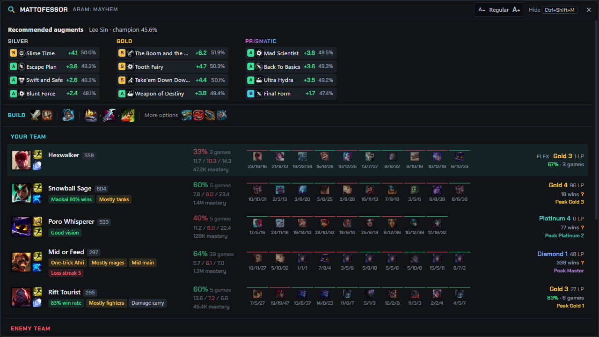
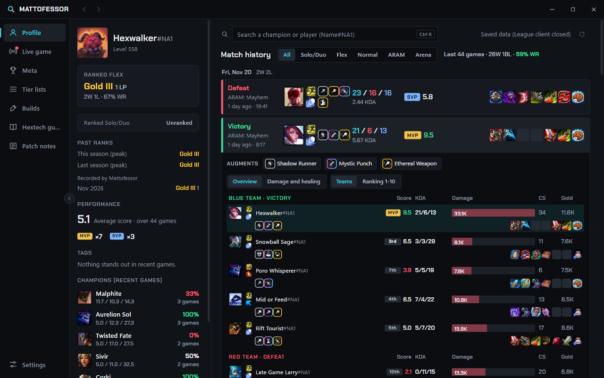
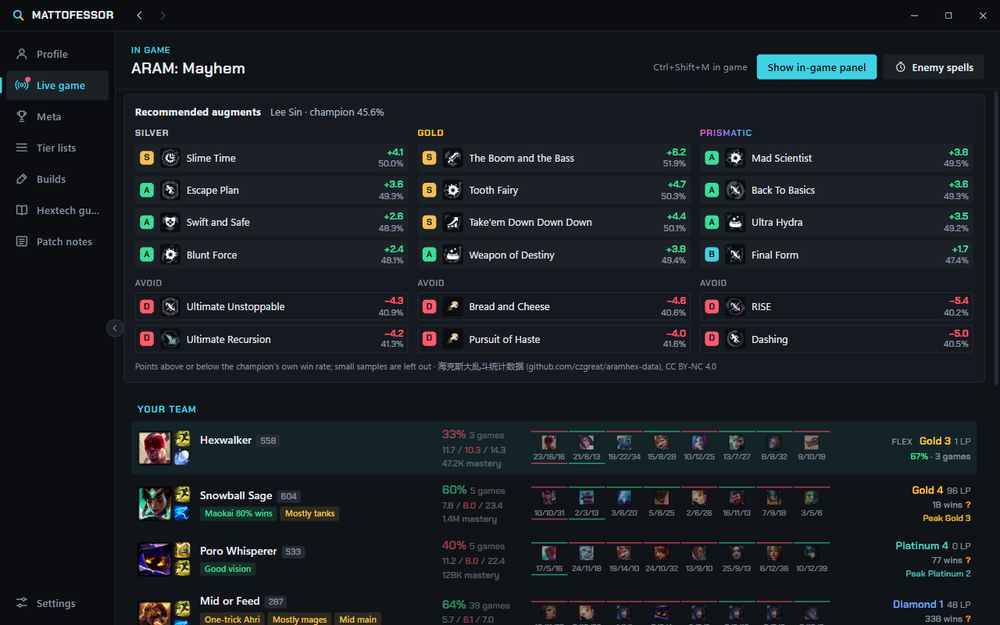
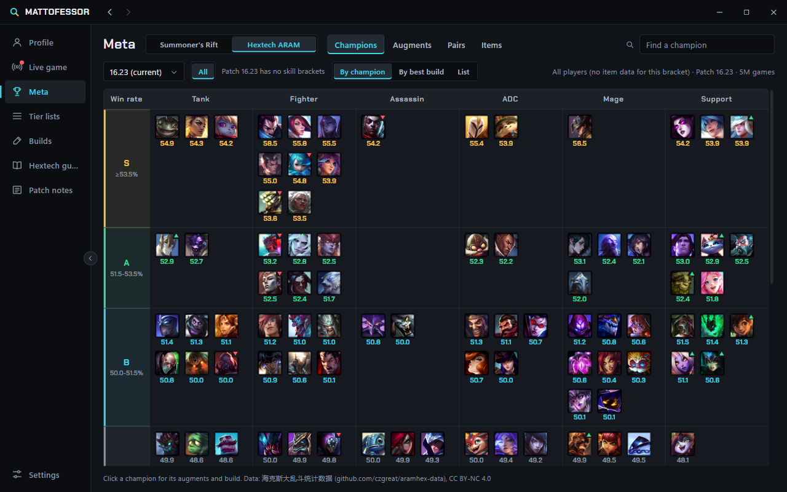
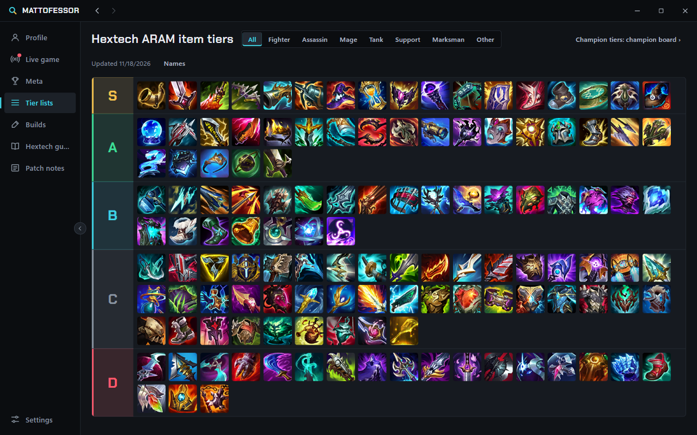
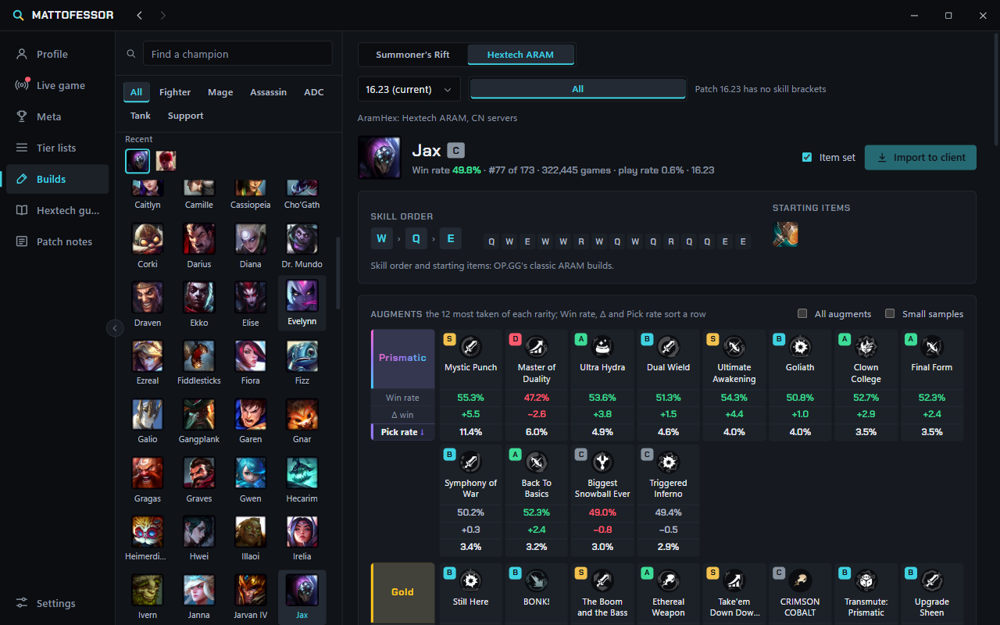
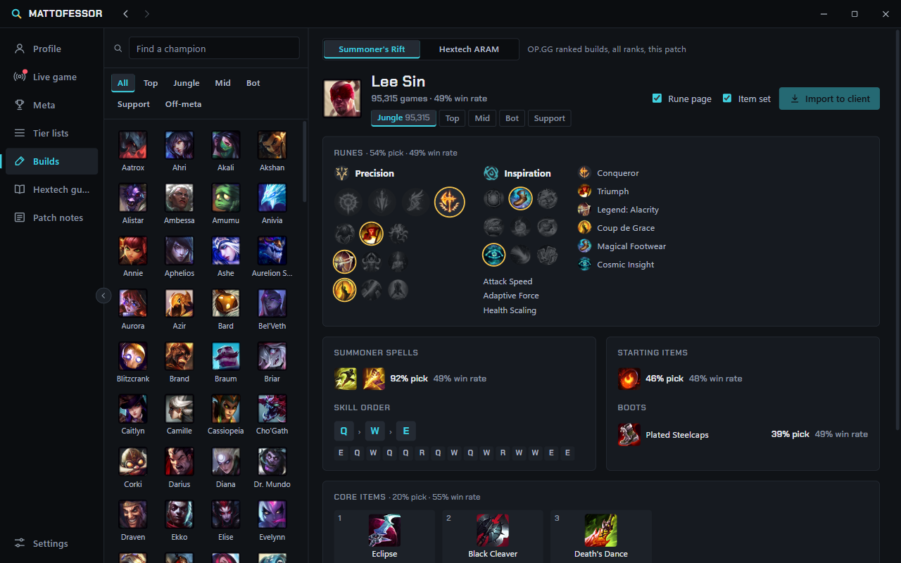
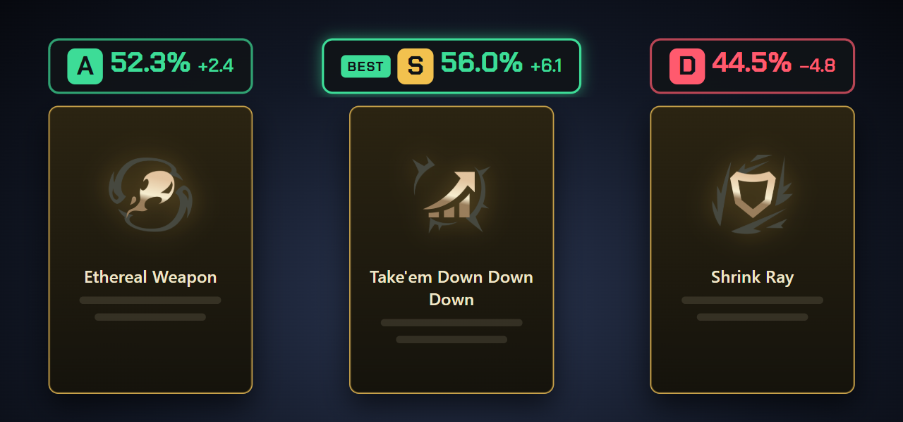
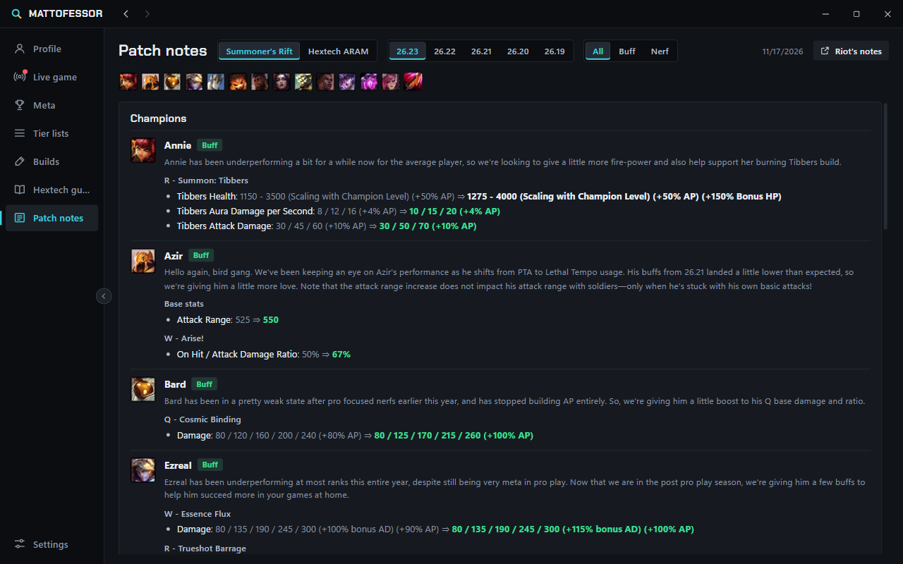

# Mattofessor

**English** · [简体中文](README.zh-CN.md) · [繁體中文](README.zh-TW.md) · [日本語](README.ja.md) · [한국어](README.ko.md) · [Español](README.es.md) · [Français](README.fr.md) · [Русский](README.ru.md)

A local Porofessor replacement for League of Legends on Windows and macOS, without Overwolf,
ads or accounts. In English, Simplified and Traditional Chinese, Japanese, Korean, Spanish, French and
Russian.

Player names in the pictures are made up.

<!-- nav -->
**[Features](#features):** [Profile](#profile) · [Live game](#live-game) · [In-game panel](#in-game-panel) · [Meta](#meta) · [Builds](#builds) · [Hextech ARAM augments](#hextech-aram-augments) · [Patch notes](#patch-notes) · [Scores](#scores) · [Small things](#small-things)  
[Install](#install) · [Updates](#updates) · [Languages](#languages) · [Appearance](#appearance) · [Optional Riot API key](#optional-riot-api-key) · [Where the data comes from](#where-the-data-comes-from) · [Contributing](#contributing) · [License](#license) · [Legal](#legal)

## Features

### Profile

Your (or any Riot ID's) solo and flex rank, past ranks, tags, most played champions, roles, mastery and match history with full 10-player game details (items and gold, or damage dealt, taken, mitigated and healing).

### Live game

In champ select it scouts your team; once the game starts, everyone (Arena included). Each player: rank and peak rank, possible smurf, games / win rate / KDA / mastery on their champion, last 5 games' KDA, and tags (one-trick, strong champion, win rate, the kind of champion they play most, premade...). Hextech ARAM and ARAM games are judged on those games alone, without the Summoner's Rift tags (role, farming, deaths).

### In-game panel

`Ctrl+Shift+M` shows / hides it over the game (chosen so it can run beside Porofessor, which uses `Ctrl+X`); it also shows by itself on the loading screen and hides when the match starts. `Ctrl+Shift+N` toggles enemy summoner spell timers (click a spell when it is used). Both hotkeys exist only while a game runs.

### Meta

Summoner's Rift tier lists per lane (win, pick and ban rates) and Hextech ARAM champion and augment win rates, by skill bracket.

<table>
  <tr>
    <td width="50%"></td>
    <td width="50%"></td>
  </tr>
</table>

### Builds

Runes with stat shards, spells, skill order, starting items, boots and items for Summoner's Rift (per lane) and ARAM, imported into the client in one click (or automatically when you lock in). In Hextech ARAM the Builds page also ranks the champion's augments. Hextech ARAM imports add an item set for each build style, in the client's language. In champ select, every champion on your team and bench shows its best build style, and you see your champion's three best augments.

<table>
  <tr>
    <td width="50%"></td>
    <td width="50%"></td>
  </tr>
</table>

### Hextech ARAM augments

In champ select and in game, the augments to take and to avoid for your champion, by rarity. When the augment cards are open, your champion's win rate with each card shows above it, the best one marked (read from the screen with the system's own text recognition, in the client's language or English; nothing is saved). Each card also gets a tier letter, S to D, by how much it lifts your champion, and the augment you click is remembered and listed in the in-game panel.

The card faces are drawn for this picture; in game the win rates sit above League's own cards.

### Patch notes

The latest 5 patches' changes, Summoner's Rift and Hextech ARAM apart, from Riot's own notes in your language (Tencent's in Simplified Chinese).

### Scores

Every player in every game gets a 0.0-10.0 performance score and a place (1st to 10th); the best on the winning team is MVP, the best on the losing team SVP.

### Small things

Accepts the ready check by itself if you want (off, Hextech ARAM only, or every queue). Hold Tab in game to see each team's item value and the gap. Set the in-game windows' opacity, and lock the spell timers in place.

## Install

1. Open this repository's **Releases** page (right side of the GitHub page) and download
   `Mattofessor_x.y.z_x64-setup.exe` from the latest release. (Do not use "Download ZIP":
   that is the source code.)
2. Run it. Windows may show "Windows protected your PC" because the installer is not
   code-signed: click **More info**, then **Run anyway**. It asks for administrator rights and
   installs to `C:\Program Files\Mattofessor` with a desktop shortcut.
3. Start League of Legends and sign in; Mattofessor connects by itself and starts with Windows
   (turn that off in Settings).
4. Optional: get your own free Riot API key for exact ranked wins and losses: Settings > Riot
   API key > **Step-by-step guide with pictures**. Each person uses their own key; never share
   yours.

Needs Windows 10 or 11 (WebView2 is installed automatically if missing). League must run in
**Borderless** or **Windowed** mode for the in-game panel to show over the game. Hotkeys:
`Ctrl+Shift+M` panel, `Ctrl+Shift+N` enemy spell timers (changeable in Settings).
Uninstall from Windows Settings > Apps; settings and cache live in `%APPDATA%\Mattofessor`.

### If your antivirus flags it

Some antivirus programs block or quarantine the installer and call it a trojan or stealer. That
is a false positive: the installer is not code-signed, and the app reads the League client's
local login file (lockfile) and the screen, which those scanners watch for. Download only from
this Releases page, then restore the file and add it and `C:\Program Files\Mattofessor` to the
antivirus's trusted list.

### macOS

1. From the latest release, download `Mattofessor_x.y.z_universal.dmg` (Apple Silicon and
   Intel), open it and drag Mattofessor to Applications.
2. For the win rates on the augment cards, allow Mattofessor in **System Settings > Privacy &
   Security > Screen & System Audio Recording** (Settings > Augment reader has a button for it),
   then restart Mattofessor. Nothing else needs a permission.

Needs macOS 13 or later (the augment card win rates need 14). The in-game hotkeys are the same
(`Ctrl` is the Control key; `Cmd` works too). Mattofessor lives in the menu bar; closing its
window keeps it there, Quit in its menu ends it. Settings and cache live in
`~/Library/Application Support/Mattofessor`, the Riot API key in your login keychain. Uninstall
by moving the app to the Trash.

## Updates

Mattofessor checks this repository's latest release in the background (no GitHub account
needed), every 30 minutes and when you open the window or bring it back to the front, and shows
a banner when a new version is out. Click **Update now** (on Windows, allow the prompt), and it
restarts on the new version; it never updates during a game. Turn the check off or run it by
hand in Settings > Updates.

## Languages

English, Simplified Chinese, Traditional Chinese (Taiwan), Japanese, Korean, Spanish, French and Russian.
Settings > Language picks one, or follows the League client. Each language shows only its own
text: game names, item and augment descriptions, rules and patch notes come from Riot's data in
that language (Tencent's for Simplified Chinese). Where a text has no translation yet, it is left
out and counted, never shown in another language.

## Appearance

Settings > Appearance: 25 built-in themes (Arcade, Rosé Pine / Moon / Dawn, Catppuccin Mocha /
Macchiato / Frappé / Latte, Tokyo Night / Storm / Day, Dracula, Nord, Gruvbox Dark / Light,
One Dark, Kanagawa, Everforest Dark / Light, Solarized Dark / Light, GitHub Dark / Light,
High Contrast Dark / Light), plus your own: copy any theme and edit every color, the two
fonts, corner roundness, in-game window opacity and light/dark; export / import themes as
text. Text size (80-140%) applies to every window, in-game panel included; in the main window
Ctrl + / Ctrl - / Ctrl + mouse wheel step it by 10% and Ctrl 0 resets it. "Keep text readable"
nudges faint text and accents to WCAG contrast.

## Optional Riot API key

The League client hides other players' ranked losses. A Riot API key fills that in: exact
ranked wins and losses (and so win rates) for every player, which also sharpens the smurf
check. Get a key at [developer.riotgames.com](https://developer.riotgames.com/) after signing in
with a Riot account and choose Register Product > Personal API Key: personal use only, approved
right away, no expiry. The Development API Key on the dashboard stops after 24 hours, so the
app's guide skips it. The key stays on your computer, encrypted (Windows) or in your login
keychain (macOS), and is never shown in the app.

## Where the data comes from

- The signed-in League client's own local API and the game's Live Client Data API. Names and
  icons come from Riot's public Data Dragon. No server of our own, no account.
- Summoner's Rift tier lists and builds: OP.GG's public endpoint
  ([opgginc/opgg-mcp](https://github.com/opgginc/opgg-mcp)).
- Hextech ARAM win rates: 海克斯大乱斗统计数据 ([czgreat/aramhex-data](https://github.com/czgreat/aramhex-data)),
  licensed [CC BY-NC 4.0](https://creativecommons.org/licenses/by-nc/4.0/), from millions of
  games on the CN servers. The app credits it wherever these numbers appear, and Mattofessor
  stays free (non-commercial).
- Hextech ARAM champion changes: the [League of Legends Wiki](https://wiki.leagueoflegends.com/en-us/ARAM:_Mayhem)
  (CC BY-SA 3.0). Augment names and descriptions: Riot's game data via
  [CommunityDragon](https://communitydragon.org).
- Patch notes: Riot's own notes in each language, Tencent's (lol.qq.com) for Simplified Chinese.

Everything is cached on your computer, so the app keeps working offline.

## Contributing

Building from source, testing with a mock game and releasing: [docs/DEVELOPMENT.md](docs/DEVELOPMENT.md).

## License

The code is under the [MIT license](LICENSE). The data it shows keeps its own license (see
"Where the data comes from"): the AramHex numbers CC BY-NC 4.0, the League of Legends Wiki lines
CC BY-SA 3.0, Riot's game data and patch notes Riot's.

## Legal

Mattofessor isn't endorsed by Riot Games and doesn't reflect the views or opinions of Riot Games
or anyone officially involved in producing or managing Riot Games properties. Riot Games, and
all associated properties are trademarks or registered trademarks of Riot Games, Inc.
