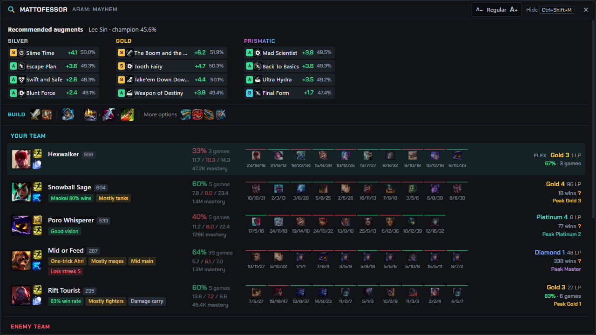
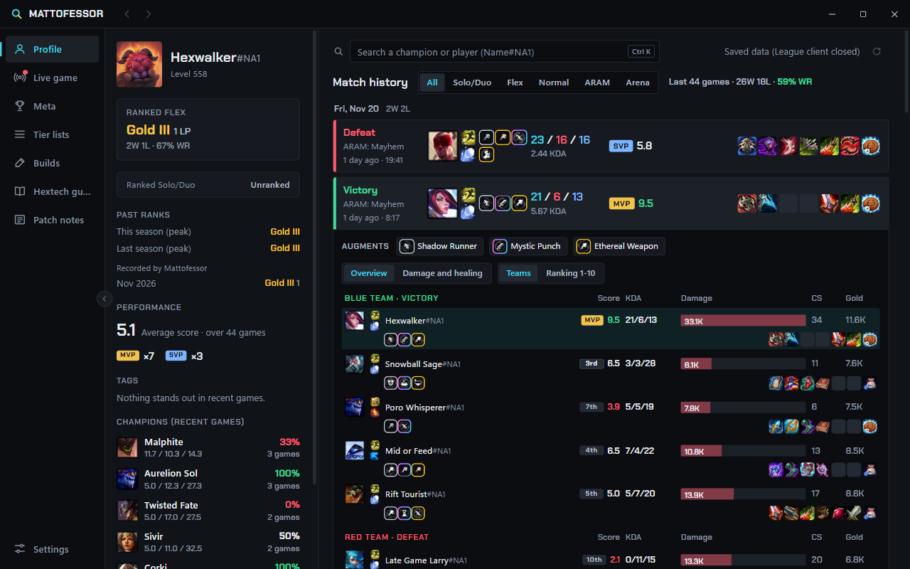
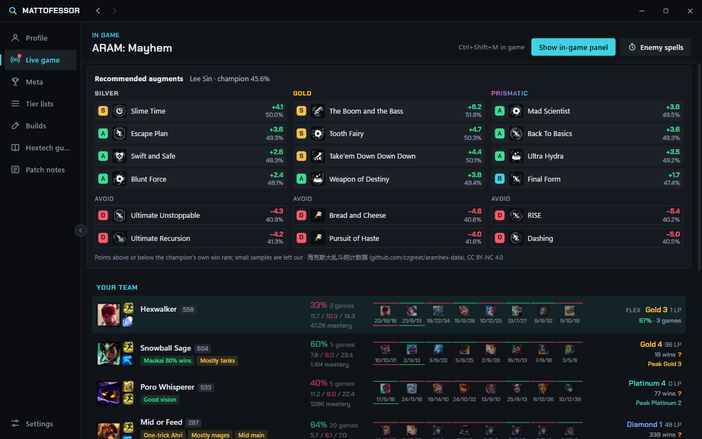
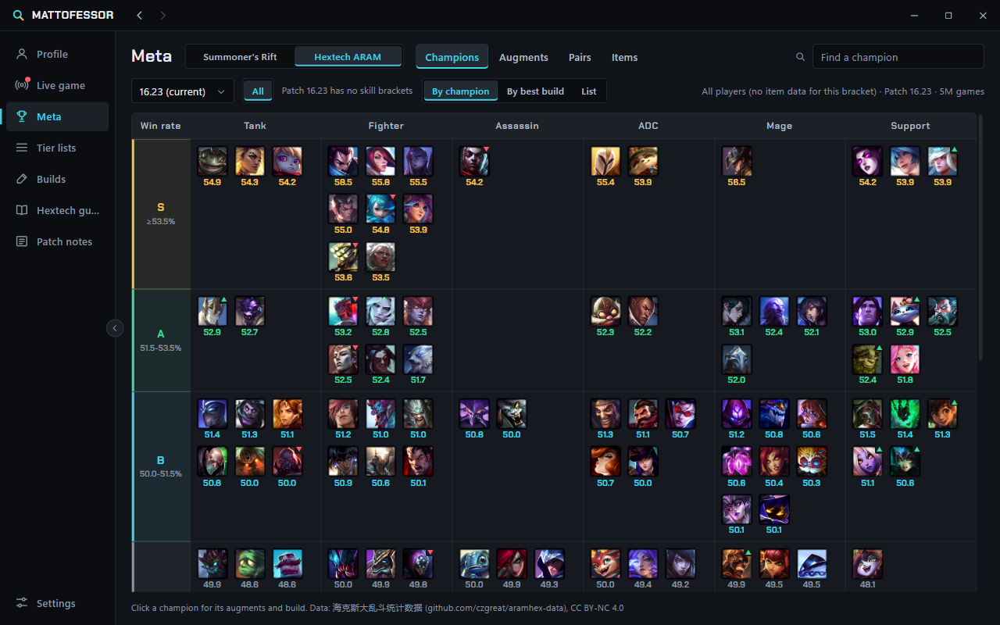
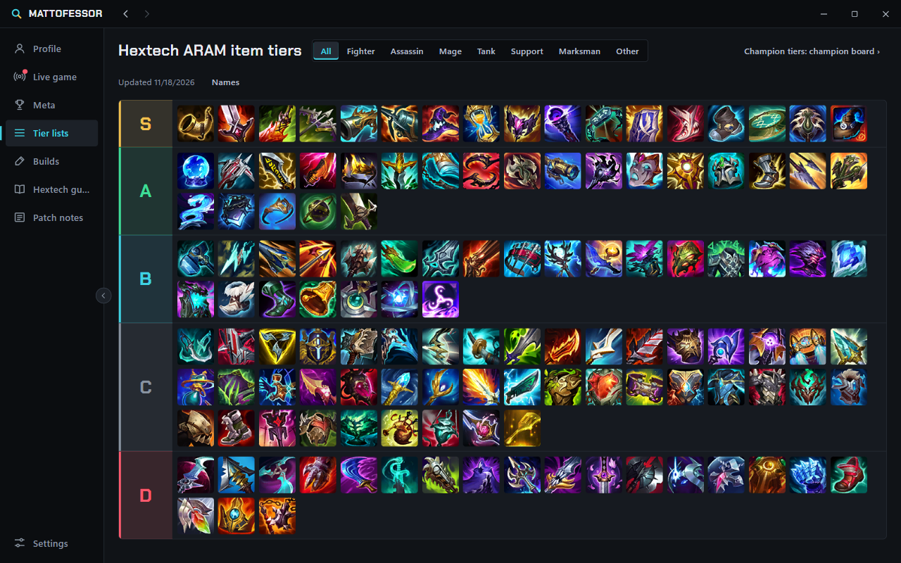
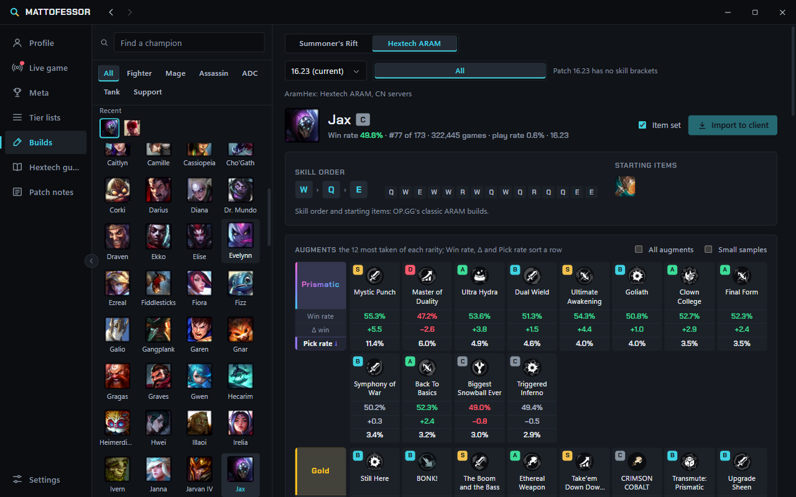
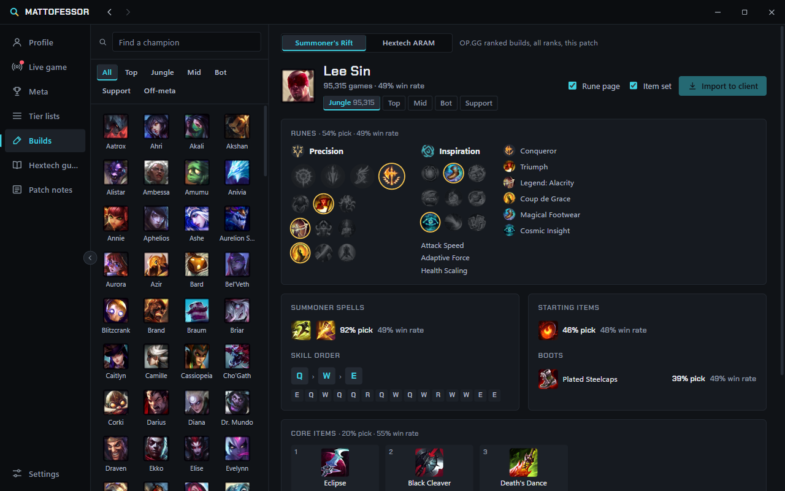
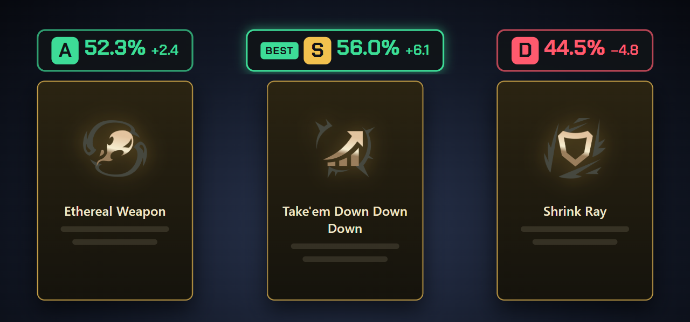
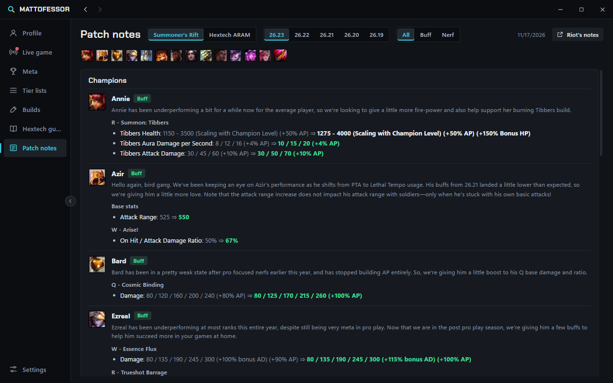

# Mattofessor

[English](README.md) · [简体中文](README.zh-CN.md) · [繁體中文](README.zh-TW.md) · [日本語](README.ja.md) · [한국어](README.ko.md) · [Español](README.es.md) · [Français](README.fr.md) · **Русский**

Локальная замена Porofessor для League of Legends на Windows и macOS: без Overwolf, рекламы и аккаунтов. На русском, английском, упрощенном и традиционном китайском, японском, корейском, испанском и французском.

> Здесь описано, как установить приложение и пользоваться им. О разработке, сборке и выпуске версий см. [README](README.md) на английском.

Имена игроков на картинках вымышлены.

<!-- nav -->
**[Возможности](#возможности):** [Профиль](#профиль) · [Текущая игра](#текущая-игра) · [Игровая панель](#игровая-панель) · [Мета](#мета) · [Сборки](#сборки) · [Аугментации ARAM: Хаос](#аугментации-aram-хаос) · [Описание обновлений](#описание-обновлений) · [Оценки](#оценки) · [Мелочи](#мелочи)  
[Установка](#установка) · [Обновления](#обновления) · [Языки](#языки) · [Необязательно: ключ Riot API](#необязательно-ключ-riot-api) · [Откуда берутся данные](#откуда-берутся-данные) · [Лицензия](#лицензия) · [Правовая информация](#правовая-информация)

## Возможности

### Профиль

Ваш ранг (или ранг любого Riot ID) в одиночной/парной и гибкой очереди, прошлые ранги, метки, самые играемые чемпионы, роли, мастерство и история матчей с полными данными всех 10 игроков каждой игры (предметы и золото или нанесенный, полученный и поглощенный урон и лечение).

### Текущая игра

На выборе чемпионов изучает вашу команду, а после начала игры всех (включая Арену). Для каждого игрока: ранг и пиковый ранг, возможный смурф, игры, доля побед, KDA и мастерство на его чемпионе, KDA за последние 5 игр и метки (ван-трик, сильный чемпион, доля побед, любимый тип чемпионов, пати...). ARAM: Хаос и ARAM оцениваются только по играм этого режима, без меток Ущелья призывателей (роль, фарм, смерти).

### Игровая панель

`Ctrl+Shift+M` показывает или скрывает ее поверх игры (выбрано так, чтобы не мешать `Ctrl+X` у Porofessor: оба могут работать вместе). Она также сама появляется на экране загрузки и скрывается, когда игра начинается. `Ctrl+Shift+N` включает или выключает таймеры заклинаний призывателя противников (нажмите на заклинание, когда его используют). Обе горячие клавиши работают только во время игры.

### Мета

Тир-листы Ущелья призывателей по ролям (доля побед, выбора и банов) и доли побед чемпионов и аугментаций в ARAM: Хаос по уровню игроков.

<table>
  <tr>
    <td width="50%"></td>
    <td width="50%"></td>
  </tr>
</table>

### Сборки

Руны с осколками характеристик, заклинания, порядок умений, стартовые предметы, ботинки и предметы для Ущелья призывателей (по ролям) и для ARAM, импорт в клиент в один клик (или автоматически при подтверждении выбора). Для ARAM: Хаос страница «Сборки» также ранжирует аугментации чемпиона. В ARAM: Хаос импорт добавляет набор предметов для каждого стиля сборки на языке клиента. На выборе чемпионов у каждого чемпиона вашей команды и скамейки виден его лучший стиль сборки, а также три лучшие аугментации вашего чемпиона.

<table>
  <tr>
    <td width="50%"></td>
    <td width="50%"></td>
  </tr>
</table>

### Аугментации ARAM: Хаос

На выборе чемпионов и в игре видно, какие аугментации брать и каких избегать на вашем чемпионе, по редкости. Когда открываются карточки аугментаций, над каждой показывается доля побед вашего чемпиона с ней, а лучшая отмечена. Карточки читает встроенное распознавание текста Windows на языке клиента или на английском; ничего не сохраняется. У каждой карточки есть и буква уровня от S до D по тому, насколько она усиливает вашего чемпиона, а аугментация, на которую вы нажали, запоминается и видна в игровой панели.

Карточки нарисованы для этой картинки; в игре доли побед показываются над настоящими карточками игры.

### Описание обновлений

Изменения последних 5 патчей, отдельно для Ущелья призывателей и ARAM: Хаос, из официальных описаний Riot на русском.

### Оценки

Каждый игрок в каждой игре получает оценку от 0,0 до 10,0 и место (с 1-го по 10-е). Лучший в победившей команде получает MVP, лучший в проигравшей SVP.

### Мелочи

Может сам принимать найденную игру (выключено, только ARAM: Хаос или все очереди). Удерживайте Tab в игре, чтобы видеть стоимость предметов каждой команды и разницу. Настраивается прозрачность игровых окон, а таймеры заклинаний можно закрепить на месте.

## Установка

1. Откройте страницу **Releases** этого репозитория (справа на GitHub) и скачайте `Mattofessor_x.y.z_x64-setup.exe` из последней версии. Не используйте «Download ZIP»: это исходный код.
2. Запустите его. У установщика нет цифровой подписи, поэтому Windows может показать «Система Windows защитила ваш компьютер»: нажмите **Подробнее**, затем **Выполнить в любом случае**. Он запросит права администратора, установится в `C:\Program Files\Mattofessor` и создаст ярлык на рабочем столе.
3. Запустите League of Legends и войдите: Mattofessor подключится сам. Он запускается вместе с Windows (это можно отключить в настройках).
4. Необязательно: получите собственный бесплатный ключ Riot API, чтобы видеть точные ранговые победы и поражения: Настройки > Ключ Riot API (необязательно) > **Пошаговая инструкция с картинками**. У каждого свой ключ; никому не давайте свой.

Нужна Windows 10 или 11 (WebView2 установится сам, если его нет). Чтобы панель показывалась поверх игры, League должна работать в режиме **Без рамки** или **В окне**. Горячие клавиши: `Ctrl+Shift+M` панель, `Ctrl+Shift+N` таймеры заклинаний противников (меняются в настройках). Удаление: Параметры Windows > Приложения. Настройки и кэш хранятся в `%APPDATA%\Mattofessor`.

### Если антивирус его блокирует

Некоторые антивирусы блокируют установщик или помещают его в карантин как троян или похититель данных. Это ложное срабатывание по двум причинам: у установщика нет цифровой подписи, а приложение читает локальный файл подключения клиента League (lockfile) и экран, то есть именно то, за чем следят такие программы. Скачивайте его только со страницы Releases этого репозитория, затем восстановите файл и добавьте его вместе с `C:\Program Files\Mattofessor` в доверенные (исключения) антивируса.

### macOS

1. Скачайте `Mattofessor_x.y.z_universal.dmg` из последнего выпуска (Apple Silicon и Intel), откройте его и перетащите Mattofessor в «Программы».
2. Чтобы видеть доли побед на карточках аугментаций, разрешите Mattofessor в **Системные настройки > Конфиденциальность и безопасность > Запись экрана и системного звука** (в Настройки > Распознавание аугментаций есть кнопка) и перезапустите Mattofessor.

Нужна macOS 13 или новее (для долей побед на карточках нужна macOS 14). Mattofessor живет в строке меню; настройки хранятся в `~/Library/Application Support/Mattofessor`, а ключ Riot хранится в связке ключей.

## Обновления

Mattofessor в фоне проверяет последнюю версию в этом репозитории (аккаунт GitHub не нужен): каждые 30 минут, а также когда вы открываете окно или возвращаетесь в него. Когда выходит новая версия, появляется уведомление: нажмите **Обновить**, подтвердите запрос Windows, и приложение перезапустится в новой версии. Во время игры оно никогда не обновляется. В разделе Настройки > Обновления можно отключить автоматическую проверку или нажать **Проверить обновления**.

## Языки

В разделе Настройки > Язык выберите язык или оставьте тот, что в клиенте League. Каждый язык показывает только свой текст: названия и описания чемпионов, предметов и аугментаций, правила и описания обновлений берутся из официальных данных Riot на этом языке. Еще не переведенное скрывается и учитывается, но никогда не показывается на другом языке.

## Необязательно: ключ Riot API

Клиент League скрывает ранговые поражения других игроков. С ключом Riot API вы видите точные победы, поражения и долю побед каждого, а распознавание смурфов становится надежнее. Войдите на [developer.riotgames.com](https://developer.riotgames.com/) со своим аккаунтом Riot и выберите Register Product > Personal API Key: только для личного использования, выдается сразу и не истекает. Development API Key на панели истекает через 24 часа, поэтому инструкция в приложении его не использует. Ключ шифруется с помощью Windows DPAPI на вашем ПК и никогда не показывается на экране.

## Откуда берутся данные

- Локальный API подключенного клиента League (LCU) и Live Client Data API игры. Названия и значки берутся из Data Dragon, публичного CDN Riot. Своих серверов у нас нет.
- Тир-листы и сборки Ущелья призывателей: публичный сервис OP.GG ([opgginc/opgg-mcp](https://github.com/opgginc/opgg-mcp)).
- Доли побед ARAM: Хаос: 海克斯大乱斗统计数据 ([czgreat/aramhex-data](https://github.com/czgreat/aramhex-data)) по лицензии [CC BY-NC 4.0](https://creativecommons.org/licenses/by-nc/4.0/), по миллионам игр на китайских серверах. Mattofessor указывает источник везде, где показаны эти цифры, и остается бесплатным (некоммерческим).
- Поправки чемпионов в ARAM: Хаос: [League of Legends Wiki](https://wiki.leagueoflegends.com/en-us/ARAM:_Mayhem) (CC BY-SA 3.0). Названия и описания аугментаций: игровые данные Riot (через [CommunityDragon](https://communitydragon.org)).
- Описания обновлений: официальные описания Riot на каждом языке.

## Лицензия

Код распространяется по [лицензии MIT](LICENSE). Показываемые данные сохраняют свои лицензии: данные AramHex по CC BY-NC 4.0, данные League of Legends Wiki по CC BY-SA 3.0, а игровые данные и описания обновлений принадлежат Riot.

## Правовая информация

Mattofessor isn't endorsed by Riot Games and doesn't reflect the views or opinions of Riot Games or anyone officially involved in producing or managing Riot Games properties. Riot Games, and all associated properties are trademarks or registered trademarks of Riot Games, Inc.
